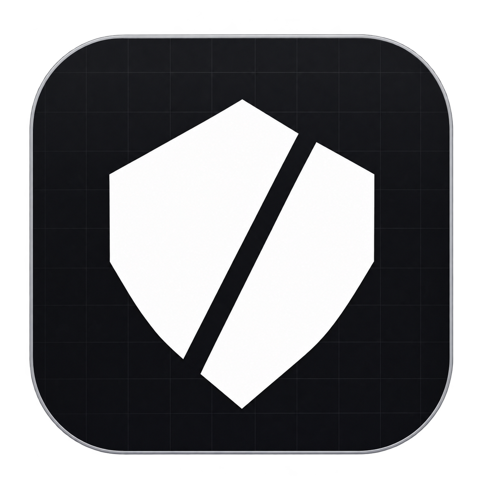
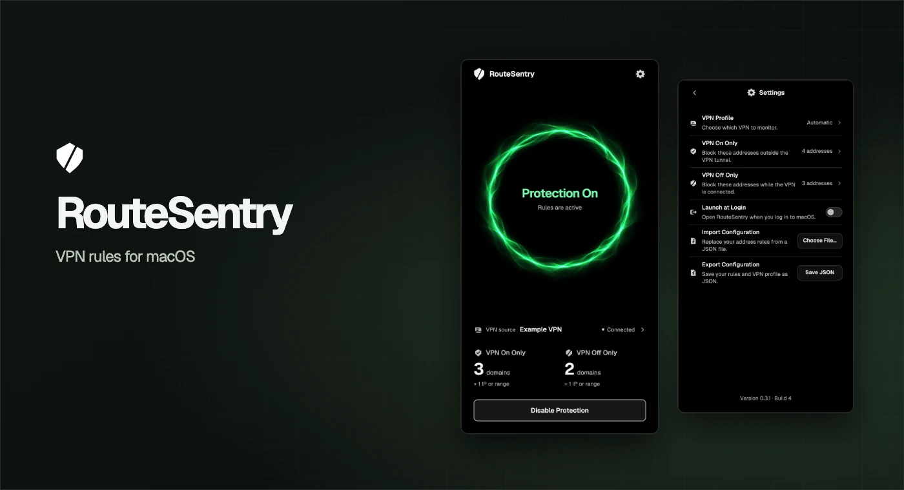
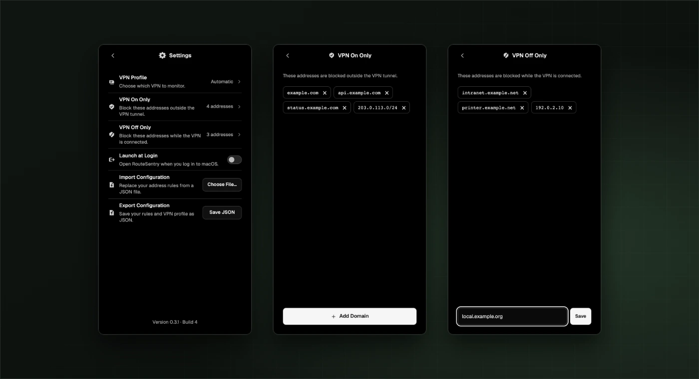

# RouteSentry

**English** · [Русский](README.ru.md) · [Download & install](#install) · [Configuration](#configuration)

**[Download RouteSentry 0.3.1 for macOS](https://github.com/MathewDyrin/RouteSentry/releases/download/v0.3.1/RouteSentry-0.3.1.dmg)** · [Release notes and checksum](https://github.com/MathewDyrin/RouteSentry/releases/tag/v0.3.1)



RouteSentry is a native macOS app that applies firewall rules to destinations you choose based on the state of your existing VPN. For example, you can keep a work hostname accessible only through the VPN and block a local service while that VPN is connected.

## How it works

| Rule | Behavior when protection is enabled |
| --- | --- |
| **VPN On Only** | Blocks matching destinations outside the detected VPN tunnel. When RouteSentry has no verified tunnel interface, it blocks them on all interfaces. |
| **VPN Off Only** | Blocks matching destinations while the selected VPN is active or its state is unknown. Access follows the system routing table when the VPN is disconnected. |

RouteSentry uses the macOS packet filter, PF. Your VPN client manages the connection, and macOS chooses the route. RouteSentry can reopen from the menu bar. The firewall service continues enforcing active rules when you close the window or quit the app.

## Install

Requires **macOS 14 or later** on Apple Silicon or Intel, administrator access to change the firewall, and Python 3 at `/usr/bin/python3` for the firewall service. Install Apple’s Command Line Tools if macOS prompts for them. [Apple’s Command Line Tools guide](https://developer.apple.com/documentation/xcode/installing-the-command-line-tools)

1. Download the DMG from [Releases → Assets](https://github.com/MathewDyrin/RouteSentry/releases). The v0.3.1 DMG uses an ad hoc signature and has no Apple notarization. You can also [build from source](#build-from-source).
2. Open the DMG and drag **RouteSentry** to **Applications**. Open the copy in Applications.
3. Open **Settings → VPN Profile**. Start with **Automatic**, or choose your VPN profile if several are active. Choose **Routed tunnel** for a full-tunnel VPN that lacks a system profile.
4. Open **VPN On Only** or **VPN Off Only**, select **Add Domain**, and enter a hostname, IP address, or CIDR. Separate several entries with commas and select **Save**.
5. Return to the main window and select **Enable Protection**. macOS asks for administrator authorization. Check that the app reports **Protection On** and displays the expected VPN. When protection is already on, select **Apply Changes** to apply edits.

**Launch at Login** opens RouteSentry when you sign in to macOS. If you uninstall the app, first select **Disable Protection** to remove the rules and the background service, then turn off **Launch at Login**.



Interface previews show example rules.

## Configuration

Use **Settings → Import Configuration → Choose File…** to load a JSON file. Import replaces both saved rule lists. Use **Export Configuration → Save JSON** to back them up. Imported edits take effect when you select **Enable Protection** or **Apply Changes**.

```json
{
  "vpn_only": ["example.com"],
  "not_vpn_only": ["203.0.113.10", "2001:db8::/32"],
  "vpn_profile": "auto"
}
```

[Open the example JSON](examples/config.json). Replace the example destinations with your own.

- `vpn_only` and `not_vpn_only` are required arrays of strings. An unused list can be `[]`.
- `vpn_profile` defaults to `"auto"` (Automatic). Use `"route"` for Routed tunnel or enter a macOS VPN profile UUID. Select a profile in the app and export the configuration to get its UUID.
- Use exact hostnames such as `api.example.com`, IPv4 or IPv6 addresses, or CIDR blocks. List each subdomain you need. Entries from the two lists must be disjoint, including overlapping CIDR blocks.

RouteSentry resolves hostnames to IP addresses and refreshes DNS periodically. Each rule applies to the resolved IPs, so other services on the same IP can also be affected. If a hostname fails to resolve when you enable protection or apply edits, RouteSentry reports it and rejects the new configuration. VPN detection requires a visible system profile and tunnel interface or a detectable full tunnel. Proxy-only VPN clients and some split tunnels may be undetectable.

## Build from source

Install Xcode or its Command Line Tools, then run:

```sh
bash build.sh
open build/RouteSentry.app
```

The script builds a universal app for Apple Silicon and Intel. The default build uses an ad hoc signature for local testing. See the [release guide](docs/RELEASING.md) for packaging, signing, tags, and GitHub Releases.
