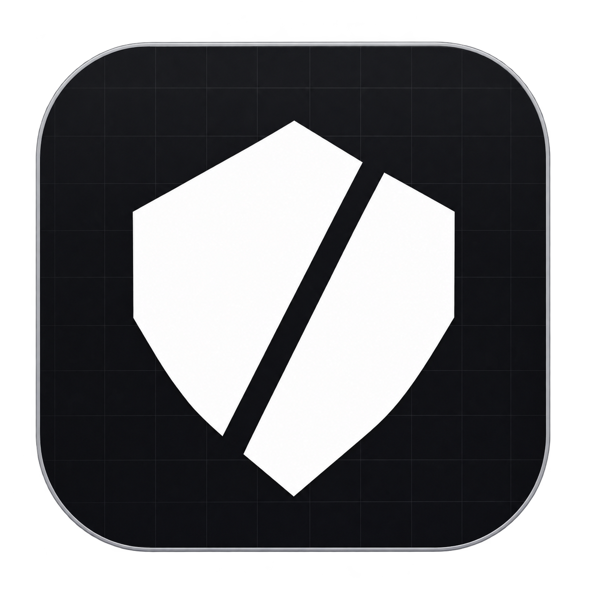
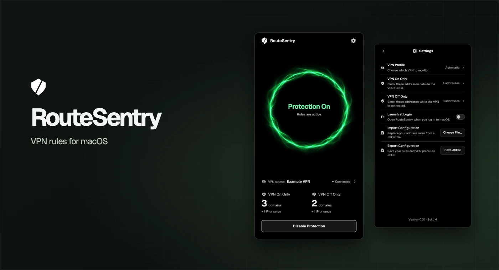
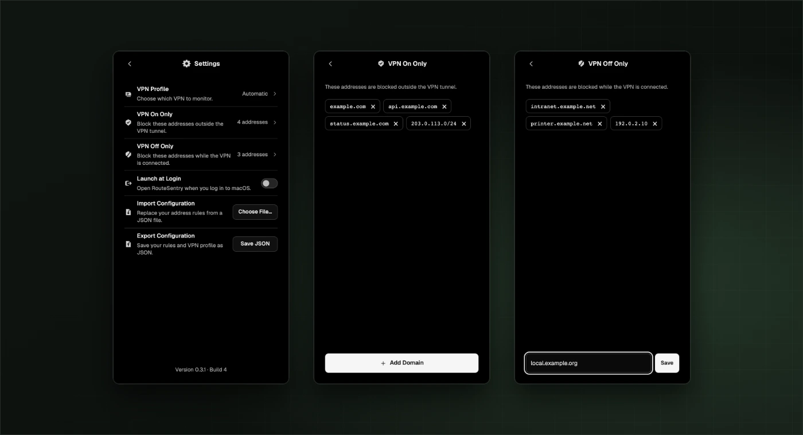

# RouteSentry

[English](README.md) · **Русский** · [Скачать и установить](#установка) · [Конфигурация](#конфигурация)

**[Скачать RouteSentry 0.3.1 для macOS](https://github.com/MathewDyrin/RouteSentry/releases/download/v0.3.1/RouteSentry-0.3.1.dmg)** · [Описание релиза и контрольная сумма](https://github.com/MathewDyrin/RouteSentry/releases/tag/v0.3.1)



RouteSentry — нативное приложение для macOS, которое применяет правила файрвола к выбранным адресам в зависимости от состояния твоего VPN. Например, можно разрешить доступ к рабочему домену только через VPN и блокировать локальный сервис, пока этот VPN подключён.

## Как это работает

| Правило | Что происходит при включённой защите |
| --- | --- |
| **VPN On Only** | Блокирует указанные адреса вне обнаруженного VPN-туннеля. Если RouteSentry не может подтвердить интерфейс туннеля, блокирует их на всех интерфейсах. |
| **VPN Off Only** | Блокирует указанные адреса, пока выбранный VPN активен или его состояние неизвестно. При отключённом VPN доступ определяется таблицей маршрутизации macOS. |

RouteSentry использует встроенный пакетный фильтр macOS, PF. Подключением управляет VPN-клиент, а маршрут выбирает macOS. Окно RouteSentry можно открыть из строки меню. Фоновая служба продолжает применять активные правила после закрытия окна или выхода из приложения.

## Установка

Нужны **macOS 14 или новее** на Apple Silicon или Intel, права администратора для изменения правил файрвола и Python 3 по пути `/usr/bin/python3` для фоновой службы. Если macOS предложит установить Command Line Tools, установи их. [Инструкция Apple](https://developer.apple.com/documentation/xcode/installing-the-command-line-tools)

1. Скачай DMG из [Releases → Assets](https://github.com/MathewDyrin/RouteSentry/releases). DMG версии 0.3.1 подписан локальной подписью без нотарификации Apple. Можно также [собрать приложение из исходников](#сборка-из-исходников).
2. Открой DMG, перетащи **RouteSentry** в **Applications** и запусти копию из этой папки.
3. Открой **Settings → VPN Profile**. Начни с **Automatic**. Если активно несколько VPN, выбери нужный профиль. Для VPN без системного профиля, который направляет весь трафик через туннель, выбери **Routed tunnel**.
4. Открой **VPN On Only** или **VPN Off Only**, нажми **Add Domain** и введи домен, IP-адрес или подсеть в формате CIDR. Несколько адресов можно разделить запятыми. Нажми **Save**.
5. Вернись на главный экран и нажми **Enable Protection**. macOS запросит подтверждение администратора. Проверь, что появился статус **Protection On** и указан нужный VPN. Если защита уже включена, примени изменения кнопкой **Apply Changes**.

**Launch at Login** запускает RouteSentry при входе в macOS. Перед удалением приложения нажми **Disable Protection**, чтобы убрать правила и фоновую службу, затем отключи **Launch at Login**.



На баннерах показаны примеры правил.

## Конфигурация

Открой **Settings → Import Configuration → Choose File…** и выбери JSON. Импорт заменяет оба сохранённых списка правил. Чтобы сделать резервную копию, нажми **Export Configuration → Save JSON**. Импортированные изменения вступят в силу после нажатия **Enable Protection** или **Apply Changes**.

```json
{
  "vpn_only": ["example.com"],
  "not_vpn_only": ["203.0.113.10", "2001:db8::/32"],
  "vpn_profile": "auto"
}
```

[Открыть пример JSON](examples/config.json). Замени адреса из примера на свои.

- `vpn_only` и `not_vpn_only` — обязательные массивы строк. Если список не нужен, укажи `[]`.
- Если пропустить `vpn_profile`, приложение выберет `"auto"` (Automatic). Для Routed tunnel укажи `"route"`. Чтобы узнать UUID конкретного профиля, выбери его в приложении и экспортируй конфигурацию.
- Можно указать точное имя хоста, например `api.example.com`, IPv4, IPv6 или подсеть CIDR. Нужные поддомены перечисляй отдельно. Адреса в двух списках должны различаться, а подсети не должны пересекаться.

RouteSentry получает IP-адреса доменов через DNS и периодически обновляет их. Правила действуют на полученные IP, поэтому могут затронуть другие сервисы на том же IP. Если домен не удаётся разрешить при включении защиты или применении правок, RouteSentry укажет его и отклонит новую конфигурацию. Для обнаружения VPN нужен видимый системный профиль с интерфейсом туннеля или обнаруживаемый полный туннель. VPN-клиенты, работающие только как прокси, и некоторые раздельные туннели могут не определяться.

## Сборка из исходников

Установи Xcode или Command Line Tools и выполни:

```sh
bash build.sh
open build/RouteSentry.app
```

Скрипт собирает универсальное приложение для Apple Silicon и Intel. По умолчанию сборка подписывается локальной подписью для тестирования. Подготовка DMG, подпись, теги и публикация описаны в [руководстве по релизам](docs/RELEASING.md#релизы).
